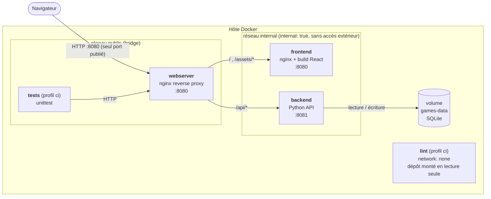
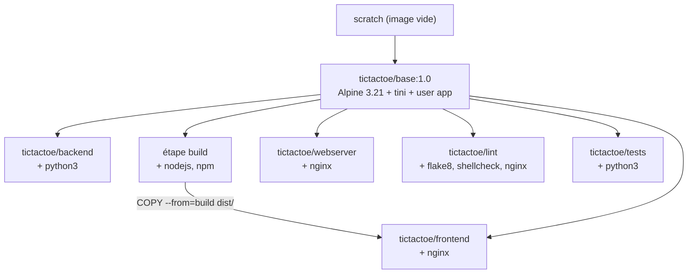
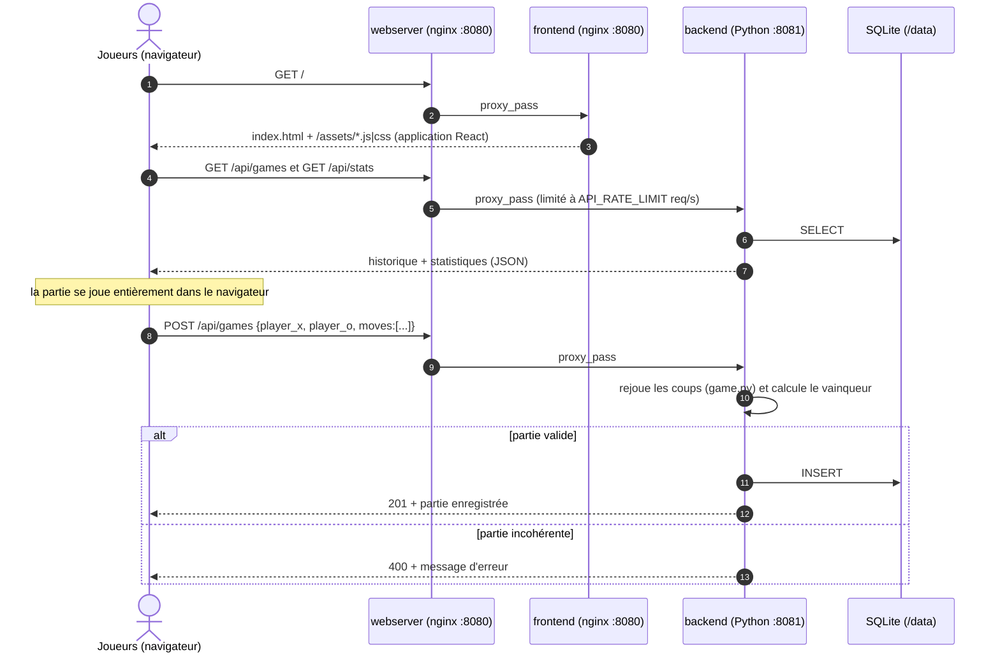
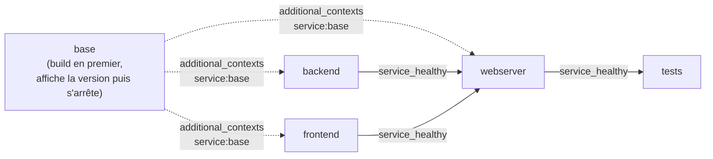

# Docker Cloud — Morpion avec historique des parties

Projet du cours Docker : un morpion (tic-tac-toe) à deux joueurs dont les parties
terminées sont enregistrées et consultables dans un historique.

| Rôle | Technologie | Image |
|---|---|---|
| Front | React 18 (compilé par Vite) servi par nginx | `tictactoe/frontend:1.0` |
| Back | Python 3.12 (bibliothèque standard + SQLite) | `tictactoe/backend:1.0` |
| Serveur web | nginx en reverse proxy, seul point d'entrée | `tictactoe/webserver:1.0` |
| CI — lint | flake8, shellcheck, `nginx -t`, contrôle des `FROM` | `tictactoe/lint:1.0` |
| CI — tests | unittest : tests unitaires + intégration de bout en bout | `tictactoe/tests:1.0` |
| Base commune | Alpine Linux construite depuis `scratch` + tini | `tictactoe/base:1.0` |

**Aucune image ne vient de Docker Hub** (ni d'un miroir comme `public.ecr.aws/docker/library`) :
la seule instruction `FROM` qui ne pointe pas vers une de nos images est `FROM scratch`,
l'image vide réservée de Docker. Le conteneur de lint vérifie automatiquement cette règle.

---

## Sommaire

1. [Démarrage rapide](#1-démarrage-rapide)
2. [Architecture](#2-architecture)
3. [Les images](#3-les-images)
4. [Arguments attendus au run](#4-arguments-attendus-au-run)
5. [Limitation des ressources](#5-limitation-des-ressources)
6. [Gestion de SIGTERM](#6-gestion-de-sigterm)
7. [Ordre de démarrage](#7-ordre-de-démarrage)
8. [CI/CD : lint et tests](#8-cicd--lint-et-tests)
9. [Docker face à la virtualisation classique](#9-docker-face-à-la-virtualisation-classique)

---

## 1. Démarrage rapide

Prérequis : Docker Engine 24+ et Docker Compose v2.21+ (pour `additional_contexts: service:`).

```bash
# Construire et lancer la stack (l'image de base est construite automatiquement en premier)
docker compose up -d --build

# Ouvrir le jeu
http://localhost:8080

# CI : lint du dépôt puis tests (les tests démarrent la stack si besoin)
docker compose --profile ci run --rm lint
docker compose --profile ci run --rm tests

# Arrêter (les conteneurs reçoivent leur signal d'arrêt et s'arrêtent proprement)
docker compose down          # ajouter -v pour effacer l'historique des parties
```

Toutes les ressources et options se règlent dans le fichier [.env](.env).

Arborescence :

```
.
├── base/                  Image de base : scratch + rootfs Alpine + tini
│   ├── Dockerfile
│   ├── fetch-rootfs.sh    (re)télécharge le rootfs et vérifie son SHA-256
│   └── alpine-minirootfs-3.21.3-x86_64.tar.gz
├── backend/               API Python (api.py, game.py, entrypoint.sh)
├── frontend/              Application React + config nginx (entrypoint.sh)
├── webserver/             Reverse proxy nginx (entrypoint.sh)
├── ci/
│   ├── lint/              Conteneur de lint
│   └── tests/             Conteneur de tests
├── docker-compose.yml
└── .env                   Arguments de run
```

---

## 2. Architecture

### Schéma de l'architecture



Les trois images applicatives (et les deux images de CI) héritent toutes de la même base :



### Schéma des communications



| Source | Destination | Port | Protocole | Réseau | Rôle |
|---|---|---|---|---|---|
| Hôte | webserver | 8080 → 8080 | HTTP | public | seul port publié |
| webserver | frontend | 8080 | HTTP | internal | fichiers statiques React |
| webserver | backend | 8081 | HTTP/JSON | internal | API `/api/*` |
| backend | volume `games-data` | — | fichier SQLite | — | persistance de l'historique |
| tests | webserver | 8080 | HTTP | public | tests de bout en bout |
| lint | — | — | — | aucun (`network_mode: none`) | lit le dépôt monté |

Choix réseau :

- **`internal`** est déclaré `internal: true` : backend et frontend n'ont **aucun accès
  à l'extérieur** et ne sont **pas publiés** sur l'hôte. On ne peut les joindre qu'en
  passant par le webserver, qui est sur les deux réseaux.
- Le webserver résout `backend` et `frontend` via le **DNS interne de Docker**
  (`127.0.0.11`) à chaque requête : si un conteneur redémarre et change d'IP, ou si on
  lance plusieurs backends (`docker compose up -d --scale backend=3`), nginx suit sans
  être redémarré.

### API du backend

| Méthode | Route | Description |
|---|---|---|
| GET | `/api/health` | sonde de santé (utilisée par le HEALTHCHECK) |
| GET | `/api/games?limit=N` | dernières parties (N ≤ `HISTORY_LIMIT`) |
| GET | `/api/stats` | nombre de victoires X, O, de nuls et total |
| POST | `/api/games` | enregistre une partie terminée `{player_x, player_o, moves}` |

Le client n'envoie que la **liste des coups** : le serveur rejoue la partie
([backend/game.py](backend/game.py)) et calcule lui-même le résultat. Une partie
incohérente (case déjà prise, coup après la victoire, partie non finie) est refusée.

---

## 3. Les images

### 3.1 `tictactoe/base` — la base commune ([base/Dockerfile](base/Dockerfile))

C'est ce qui permet de se passer totalement de Docker Hub.

| Instruction | Explication |
|---|---|
| `FROM scratch` | Image vide intégrée à Docker : aucun téléchargement de registre. |
| `ADD alpine-minirootfs-3.21.3-x86_64.tar.gz /` | Le *minirootfs* est le système de fichiers officiel minimal d'Alpine (~3,5 Mo), publié sur `dl-cdn.alpinelinux.org`. `ADD` décompresse l'archive locale directement à la racine. Il est versionné dans le dépôt ; [base/fetch-rootfs.sh](base/fetch-rootfs.sh) le retélécharge et **vérifie son empreinte SHA-256**. |
| `ENV PATH=… LANG=C.UTF-8 TZ=Europe/Paris` | Une image `scratch` n'a aucune variable d'environnement : on définit le `PATH`, l'encodage et le fuseau horaire. |
| `apk upgrade` | Applique les correctifs de sécurité publiés depuis la sortie du rootfs (3.21.3 → 3.21.x). |
| `apk add tini` | **Mini-init** utilisé comme PID 1 dans tous les conteneurs (voir §6). |
| `apk add ca-certificates` | Certificats racine pour les téléchargements HTTPS (`apk`, `npm`). |
| `apk add tzdata` + `cp …/Europe/Paris /etc/localtime` | Heure locale correcte dans les logs et l'horodatage des parties. |
| `addgroup`/`adduser app` (uid/gid 10001) | Utilisateur système **sans shell (`/sbin/nologin`) ni home**, utilisé par tous les services : rien ne tourne en root. Un uid élevé évite toute collision avec un utilisateur de l'hôte. |
| `ENTRYPOINT ["/sbin/tini", "--"]` | Tout conteneur basé sur cette image a tini comme PID 1. |

Arguments de build : `ALPINE_VERSION` (3.21.3) et `ALPINE_ARCH` (`x86_64`, ou `aarch64`
après `./base/fetch-rootfs.sh aarch64` pour un Mac Apple Silicon).

### 3.2 `tictactoe/backend` — API Python ([backend/Dockerfile](backend/Dockerfile))

| Élément | Explication |
|---|---|
| `apk add python3` | Python 3.12 des dépôts Alpine. Il embarque `http.server` et `sqlite3` : **aucune dépendance pip**, donc pas de `pip`, pas de compilateur, image plus petite et surface d'attaque réduite. |
| `PYTHONDONTWRITEBYTECODE=1` | Pas de fichiers `.pyc` (le système de fichiers est de toute façon en lecture seule). |
| `PYTHONUNBUFFERED=1` | Les logs sortent immédiatement sur stdout → visibles dans `docker logs`. |
| `sed -i 's/\r$//'` + `chmod 0755` sur `entrypoint.sh` | Supprime les fins de ligne Windows (CRLF) qui casseraient le shebang si le dépôt est cloné sous Windows, et rend le script exécutable. |
| `mkdir /data && chown app:app /data` + `VOLUME /data` | Dossier de la base SQLite. Le volume nommé hérite de ces droits à sa création : l'utilisateur `app` peut y écrire sans être root. |
| `USER app` | Exécution non-root. |
| `EXPOSE 8081` | Port de l'API (documentaire : il n'est **pas** publié sur l'hôte). |
| `HEALTHCHECK … wget /api/health` | `wget` vient de BusyBox, déjà présent dans Alpine : pas besoin d'installer `curl`. |

### 3.3 `tictactoe/frontend` — React ([frontend/Dockerfile](frontend/Dockerfile))

Build **multi-étapes** :

1. **Étape `build`** (base + `apk add nodejs npm`) : `npm install` puis `vite build`.
   `package.json` est copié seul avant le code pour que la couche `npm install` reste en
   cache tant que les dépendances ne changent pas. Les versions sont **figées**
   (`react 18.3.1`, `vite 5.4.11`…) pour un build reproductible.
2. **Étape finale** (base + `apk add nginx`) : ne reçoit que le dossier `dist/`
   (`COPY --from=build`). Node, npm et `node_modules` (~ 100 Mo) **ne sont pas dans
   l'image finale** : elle pèse 17,6 Mo.

| Élément | Explication |
|---|---|
| `rm /etc/nginx/http.d/default.conf` | Supprime le site par défaut du paquet nginx ; notre config complète est générée au démarrage. |
| `nginx.conf` → `/etc/nginx/nginx.conf.template` | Modèle avec des `__VARIABLES__` remplacées par l'entrypoint. Fichiers temporaires et PID dans `/tmp`, logs vers stdout/stderr, gzip, cache long sur `/assets/` (noms de fichiers hashés par Vite), repli sur `index.html` (application monopage). |
| `USER app` + `EXPOSE 8080` | Non-root, donc port > 1024 (un port < 1024 exigerait la capability `NET_BIND_SERVICE`). |
| `STOPSIGNAL SIGQUIT` | Voir §6. |

### 3.4 `tictactoe/webserver` — reverse proxy ([webserver/Dockerfile](webserver/Dockerfile))

Même socle que le frontend (`apk add nginx`, config par défaut supprimée, non-root, port 8080,
`STOPSIGNAL SIGQUIT`). La configuration ([webserver/nginx.conf](webserver/nginx.conf)) :

- `/api/*` → backend, avec **limitation de débit** (`limit_req`) pour protéger le backend
  dont les ressources sont limitées ;
- tout le reste → frontend ;
- `/healthz` → répond directement (sonde de santé) ;
- `resolver 127.0.0.11` + `proxy_pass` via variable : résolution DNS dynamique (cf. §2) ;
- `client_max_body_size` réduit (16 Ko) : une partie ne fait que quelques octets ;
- `server_tokens off` : la version de nginx n'est pas exposée.

### 3.5 Choix des entrypoints

Tous les services utilisent la forme **exec** (tableau JSON) et la même chaîne :

```
ENTRYPOINT ["/sbin/tini", "--", "/usr/local/bin/entrypoint.sh"]
                 │                        │
                 │                        └─ script shell : lit et VALIDE les variables
                 │                           d'environnement, génère la config, puis
                 │                           « exec » le vrai process (python3 / nginx)
                 └─ PID 1 : relaie les signaux et récupère les zombies
```

Pourquoi ce choix :

- **Forme exec et non forme shell** (`ENTRYPOINT cmd args`) : la forme shell lance
  `/bin/sh -c`, qui devient PID 1 et **ne transmet pas SIGTERM** à son enfant.
- **tini en PID 1** : le noyau ne fournit aucun gestionnaire de signal par défaut au PID 1
  d'un namespace ; un process qui ne gère pas explicitement SIGTERM l'ignorerait. tini
  relaie les signaux au process fils et récupère les process zombies.
- **Script d'entrée** : il transforme les arguments du run (variables d'environnement) en
  configuration et **refuse de démarrer** si une valeur est invalide
  (`WORKER_PROCESSES=abc` → message clair et code de sortie 1, au lieu d'une erreur nginx
  obscure). Pour nginx, la config est validée par `nginx -t` avant le lancement.
- **`exec` à la fin du script** : le shell est *remplacé* par python3/nginx (même PID) ;
  tini signale donc directement le bon process.
- **`ENTRYPOINT` plutôt que `CMD`** : le conteneur a un rôle fixe ; un `docker run image
  --option` ajoute des arguments au lieu de remplacer le programme.
- Pour les conteneurs de CI, l'entrypoint est le programme de vérification lui-même
  (`lint.sh`, `python3 -m unittest`) : le **code de sortie** du conteneur est le verdict
  (0 = succès), directement exploitable par un pipeline.

---

## 4. Arguments attendus au run

Chaque conteneur reçoit deux familles d'arguments, toutes définies dans [.env](.env) et
traduites dans [docker-compose.yml](docker-compose.yml) :

1. **Ressources allouées** par Docker (CPU, mémoire, nombre de process) → `deploy.resources`.
2. **Dimensionnement applicatif** du process (workers, connexions, files d'attente…) →
   `environment`, lus par l'entrypoint.

### backend

| Variable (.env) | Variable conteneur | Défaut | Rôle |
|---|---|---|---|
| `BACKEND_PORT` | `PORT` | 8081 | port d'écoute de l'API |
| `BACKEND_HISTORY_LIMIT` | `HISTORY_LIMIT` | 20 | nb max de parties renvoyées (borne la taille des réponses et la mémoire) |
| `BACKEND_REQUEST_QUEUE_SIZE` | `REQUEST_QUEUE_SIZE` | 64 | taille de la file de connexions en attente (`listen backlog`) |
| — | `DB_PATH` | /data/games.db | fichier SQLite (dans le volume) |

### frontend

| Variable (.env) | Variable conteneur | Défaut | Rôle |
|---|---|---|---|
| `FRONTEND_WORKER_PROCESSES` | `WORKER_PROCESSES` | 1 | nb de workers nginx (`auto` = 1 par CPU visible) |
| `FRONTEND_WORKER_CONNECTIONS` | `WORKER_CONNECTIONS` | 256 | connexions simultanées max par worker |

### webserver

| Variable (.env) | Variable conteneur | Défaut | Rôle |
|---|---|---|---|
| `WEBSERVER_PUBLIC_PORT` | (port publié) | 8080 | port ouvert sur l'hôte |
| `WEBSERVER_WORKER_PROCESSES` | `WORKER_PROCESSES` | 2 | nb de workers nginx |
| `WEBSERVER_WORKER_CONNECTIONS` | `WORKER_CONNECTIONS` | 512 | connexions max par worker |
| `WEBSERVER_CLIENT_MAX_BODY_SIZE` | `CLIENT_MAX_BODY_SIZE` | 16k | taille max d'une requête |
| `WEBSERVER_API_RATE_LIMIT` | `API_RATE_LIMIT` | 20 | requêtes/s max par IP vers l'API |
| — | `BACKEND_HOST` / `BACKEND_PORT` | backend / 8081 | adresse du backend |
| — | `FRONTEND_HOST` / `FRONTEND_PORT` | frontend / 8080 | adresse du frontend |

### lint / tests

| Variable (.env) | Variable conteneur | Défaut | Rôle |
|---|---|---|---|
| `LINT_MAX_LINE_LENGTH` | `FLAKE8_MAX_LINE_LENGTH` | 110 | longueur de ligne max Python |
| `TESTS_TIMEOUT` | `TEST_TIMEOUT` | 5 | timeout (s) de chaque requête HTTP de test |
| — | `BASE_URL` | http://webserver:8080 | cible des tests d'intégration |

Équivalent sans compose, par exemple pour le backend :

```bash
docker run -d --name backend \
  --cpus 0.5 --memory 128m --memory-reservation 32m --pids-limit 64 \
  --read-only --tmpfs /tmp --cap-drop ALL --security-opt no-new-privileges \
  -e HISTORY_LIMIT=20 -e REQUEST_QUEUE_SIZE=64 \
  -v games-data:/data \
  tictactoe/backend:1.0
```

---

## 5. Limitation des ressources

Valeurs par défaut (modifiables dans `.env`) :

| Service | CPU max | RAM max | CPU réservé | RAM réservée | PIDs max | Conso. mesurée au repos |
|---|---|---|---|---|---|---|
| backend | 0,50 | 128 Mo | 0,10 | 32 Mo | 64 | ~11 Mo, 2 PIDs |
| frontend | 0,25 | 64 Mo | 0,05 | 16 Mo | 32 | ~2 Mo, 3 PIDs |
| webserver | 0,50 | 64 Mo | 0,05 | 16 Mo | 32 | ~3 Mo, 4 PIDs |
| lint | 1,00 | 256 Mo | — | — | 64 | ponctuel |
| tests | 0,50 | 128 Mo | — | — | 32 | ponctuel |

Ce que fait chaque limite :

- **`limits.cpus`** (`--cpus`) : quota CFS du cgroup. `0.50` = au plus une demi-seconde de
  CPU par seconde. Un process qui boucle ne peut pas affamer les autres conteneurs.
- **`limits.memory`** (`--memory`) : plafond dur. S'il est dépassé, le noyau tue le process
  (OOM killer) **dans ce conteneur seulement**, puis `restart: unless-stopped` le relance.
- **`reservations`** (`--cpu-shares`/`--memory-reservation`) : minimum garanti quand l'hôte
  est sous pression ; c'est aussi ce qu'un orchestrateur utiliserait pour placer le conteneur.
- **`limits.pids`** (`--pids-limit`) : nombre max de process/threads. Protège contre une
  *fork bomb* ou une explosion de threads (le backend crée un thread par requête).

Justification des valeurs :

- **backend** : le plus gourmand (interpréteur Python ~11 Mo + 1 thread par requête +
  cache SQLite) → 128 Mo et 0,5 CPU. `REQUEST_QUEUE_SIZE` et la limite de débit du proxy
  bornent le nombre de requêtes simultanées, donc de threads, cohérent avec `pids: 64`.
- **frontend** : ne sert que des fichiers statiques déjà compressibles → 0,25 CPU,
  64 Mo, 1 worker suffisent largement.
- **webserver** : point d'entrée de tout le trafic → 2 workers et 0,5 CPU. Capacité
  théorique = `WORKER_PROCESSES × WORKER_CONNECTIONS` = 1024 connexions, sachant qu'en
  proxy chaque requête consomme 2 connexions (client + amont).
- **lint/tests** : courts, ils ont droit à plus de CPU pour finir vite.

Durcissement appliqué aussi à tous les services (ancre YAML `x-hardening`) :
`read_only: true` (système de fichiers en lecture seule, `/tmp` en tmpfs de 16 Mo),
`cap_drop: [ALL]` (aucune capability Linux), `no-new-privileges`, et rotation des logs
(`max-size: 5m`, 2 fichiers) pour que les logs ne remplissent pas le disque.

Vérification :

```bash
docker stats --no-stream
docker inspect -f '{{.HostConfig.NanoCpus}} {{.HostConfig.Memory}} {{.HostConfig.PidsLimit}}' tictactoe-backend-1
```

---

## 6. Gestion de SIGTERM

`docker stop` / `docker compose down` envoie le signal d'arrêt de l'image, attend
`stop_grace_period` (10 s), puis envoie **SIGKILL**. Un service bien conçu doit s'arrêter
proprement avant.

| Service | Signal reçu | Traitement |
|---|---|---|
| tous | — | **tini** (PID 1) relaie le signal ; l'entrypoint a fait `exec`, il n'y a donc pas de shell intermédiaire qui l'avalerait. |
| backend | SIGTERM | gestionnaire Python `signal.signal(SIGTERM, …)` : appelle `server.shutdown()` (depuis un thread, car il attend la fin de `serve_forever()`), la requête en cours se termine, le socket est fermé, puis log `API arrêtée.` |
| frontend, webserver | **SIGQUIT** (`STOPSIGNAL SIGQUIT`) | pour nginx, SIGTERM = arrêt **immédiat** ; SIGQUIT = arrêt **gracieux** : il cesse d'accepter des connexions et termine celles en cours. |
| lint | SIGTERM | `trap` dans `lint.sh` : message et sortie 143. |
| tests | SIGTERM | tini transmet à Python qui s'arrête (comportement par défaut). |

Vérification : un arrêt propre renvoie le code 0 ; un SIGKILL donnerait 137.

```bash
docker compose stop backend && docker compose logs backend --tail 2
#  backend-1  | Signal SIGTERM reçu, arrêt propre...
#  backend-1  | API arrêtée.
docker inspect -f '{{.State.ExitCode}}' tictactoe-backend-1   # 0
```

---

## 7. Ordre de démarrage



- **Au build** : chaque service déclare `additional_contexts: tictactoe/base:1.0: service:base`.
  Compose construit donc l'image `base` **avant** les autres, sans script externe.
- **Au run** : le webserver a `depends_on: condition: service_healthy` sur le backend et le
  frontend. Il ne démarre que lorsque leurs `HEALTHCHECK` répondent (et non simplement
  quand les conteneurs sont créés), ce qui évite des erreurs 502 au démarrage.
- **tests** dépend du webserver *healthy* : `docker compose run tests` démarre toute la
  chaîne dans le bon ordre, puis lance les tests.

---

## 8. CI/CD : lint et tests

Consigne supplémentaire : deux conteneurs dédiés à la CI, dans le profil `ci` (ils ne
démarrent pas avec un simple `docker compose up`).

### `lint` ([ci/lint](ci/lint))

```bash
docker compose --profile ci run --rm lint
```

- Paquets : `py3-flake8` (Python), `shellcheck` (scripts shell), `nginx` (pour `nginx -t`).
- Le dépôt est monté **en lecture seule** (`./:/src:ro`), `network_mode: none` : le lint
  n'a besoin ni de modifier les fichiers ni du réseau.
- Vérifications : flake8 sur le Python, shellcheck sur tous les `*.sh`, validation
  syntaxique des **modèles nginx** (variables remplacées par des valeurs de test), et une
  **règle maison** : tout `FROM` doit être `scratch` ou `tictactoe/*` — garantit la
  contrainte « 0 image Docker Hub ».
- Toutes les vérifications s'exécutent ; le code de sortie vaut 1 si l'une échoue.

### `tests` ([ci/tests](ci/tests))

```bash
docker compose --profile ci run --rm tests
```

- Paquet : `python3` (unittest et urllib suffisent).
- **Tests unitaires** ([test_game.py](ci/tests/test_game.py)) : règles du jeu (victoire,
  nul, case occupée, coup après la fin…), sur `backend/` monté en lecture seule.
- **Tests d'intégration** ([test_api.py](ci/tests/test_api.py)) : à travers le reverse
  proxy comme un vrai navigateur — santé, page React, repli SPA, enregistrement d'une
  partie puis présence dans l'historique et les stats, refus d'une partie invalide, 404.
- 15 tests, code de sortie 0/1.

Exemple de pipeline (n'importe quel runner disposant de Docker) :

```bash
docker compose --profile ci build
docker compose --profile ci run --rm lint
docker compose --profile ci run --rm tests
docker compose down -v
```

---

## 9. Docker face à la virtualisation classique

| | Machine virtuelle | Conteneur Docker (ce projet) |
|---|---|---|
| Isolation | hyperviseur + noyau invité complet | namespaces + cgroups du noyau hôte |
| Taille | plusieurs Go par VM | base 16 Mo, frontend/webserver ~17,5 Mo, backend ~57 Mo |
| Démarrage | dizaines de secondes | < 1 s par service |
| Limitation des ressources | vCPU/RAM fixes, allouées à l'avance | quotas cgroups ajustables (`.env`), réservations souples |
| Reproductibilité | images disque opaques | Dockerfiles texte, versionnés, rejouables |
| Mutualisation | chaque VM a son OS | une seule couche `base` partagée sur disque par les 6 images |

Et sans Docker Hub : en partant de `scratch` et du rootfs officiel d'Alpine, on maîtrise
toute la chaîne — on sait exactement ce que contient chaque image, ce qui démystifie les
« images officielles » : ce ne sont que des archives de système de fichiers plus des
métadonnées.
